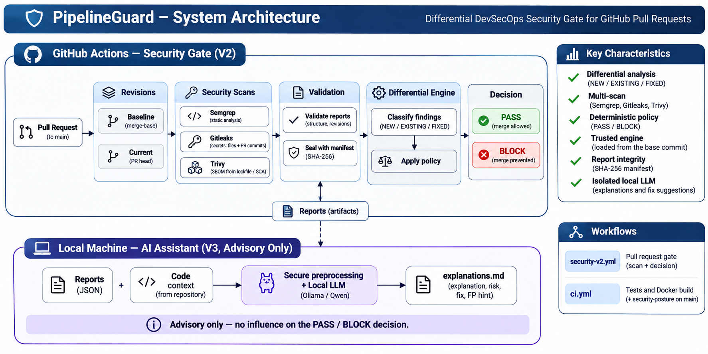


# PipelineGuard

**Differential DevSecOps Security Gate with a Local LLM Assistant**

PipelineGuard automates security checks on GitHub pull requests by combining static analysis, secret detection and dependency vulnerability scanning.

Unlike traditional security gates, it distinguishes newly introduced findings from existing security debt, allowing teams to improve security without unnecessarily blocking development.

## Key Features

- **Multi-scanner analysis:** Semgrep (SAST), Gitleaks (secrets) and Trivy (SBOM-based dependency scanning).
- **Differential analysis:** NEW, EXISTING and FIXED findings.
- **Deterministic security gate:** automated PASS/BLOCK decisions with a fail-closed policy.
- **Security hardening:** pinned tools, trusted engine and rules, report integrity verification.
- **Local AI assistant:** optional LLM-generated explanations and remediation suggestions, independent of security decisions.

## Architecture

## Security Policy

| Classification | Description | Blocking conditions |
|---|---|---|
| NEW | Introduced by the PR | Secrets, HIGH, CRITICAL |
| EXISTING | Already present in the baseline | Secrets, CRITICAL |
| FIXED | Removed by the PR | Never |

Secrets detected in PR commits also block the PR, even if removed in a later commit. Missing, invalid or inconsistent security evidence results in BLOCK.

## Local LLM Assistant

The optional assistant uses Ollama to explain scanner findings, assess risks and suggest remediation.

It runs locally, on demand, using scanner reports and relevant code context.

**The LLM never takes or changes the PASS/BLOCK decision.**

## Validation

- 259 automated engine and assistant tests.
- Real GitHub Actions validation of PASS and BLOCK scenarios.
- Detection of secrets added and subsequently removed within a PR.
- Differential matching of findings whose source lines have moved.
- Prompt injection resistance improved from 0/9 to 9/9 on targeted comment and docstring injection tests.

The LLM evaluation uses a small, controlled dataset and does not establish general model reliability.

## Documentation

| Document | Description |
|---|---|
| [Architecture](docs/architecture.md) | Workflows, components and repository structure |
| [Security Engine](docs/engine.md) | Differential analysis and decision policy |
| [Security Controls](docs/security.md) | Hardening mechanisms and known limitations |
| [LLM Assistant](docs/llm-assistant.md) | Usage, safeguards and evaluation |
| [Validation](docs/validation.md) | Test suite and real CI/CD results |
| [Architecture Decisions](DECISIONS.md) | Key technical choices and rationale |

## Technology Stack

Python · GitHub Actions · Docker · FastAPI · Semgrep · Gitleaks · Trivy · CycloneDX · Pytest · Ollama

## Project Status

V3.0.0 — Educational and portfolio project.

PipelineGuard is not a production-hardened security boundary. A PASS indicates that the configured security controls have accepted the change, not that the code is free of vulnerabilities.
