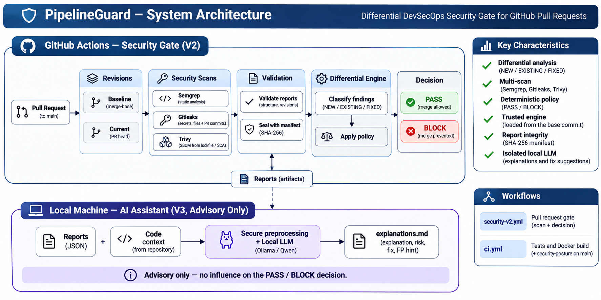

# PipelineGuard Architecture

[Back to README](../README.md)

## System Overview

PipelineGuard separates automated security enforcement from optional AI-assisted remediation.

The V2 security gate runs in GitHub Actions and evaluates pull requests using deterministic security policies. The V3 assistant runs locally and provides explanations without influencing security decisions.



## 1. Pull Request Security Gate

Workflow: `.github/workflows/security-v2.yml`

The gate consists of two independent CI jobs.

### V2 Scan Job

1. Check out the candidate repository at the PR head.
2. Load approved scanner rules and configuration from the base commit.
3. Resolve the merge-base and PR head.
4. Prepare baseline and current worktrees.
5. Run security scanners against both revisions.
6. Scan the commits introduced by the PR for secrets.
7. Validate scanner reports and SBOM inventories.
8. Seal scanner reports using a SHA-256 manifest.
9. Upload the scan artifacts.

| Scanner | Purpose | Scan scope |
|---|---|---|
| Semgrep | Static application security testing | Baseline and current source code |
| Gitleaks | Secret detection | Both revisions and PR commits |
| Trivy | Dependency vulnerability scanning | CycloneDX SBOMs generated from lockfiles |

### V2 Security Decision Job

1. Download the scan artifacts.
2. Load the approved engine and policy from the base commit.
3. Verify Git revisions, report structure and manifest integrity.
4. Normalize scanner findings.
5. Perform differential classification.
6. Apply the security policy.
7. Return PASS or BLOCK.

The decision job is a required GitHub check for merging into `main`.

See [Security Engine](engine.md) for the detailed decision logic.

## 2. Continuous Integration and Security Posture

Workflow: `.github/workflows/ci.yml`

This workflow has a different responsibility from the pull request security gate.

| Job | Trigger | Responsibility |
|---|---|---|
| CI | Pull requests and pushes | Automated tests, Semgrep rule tests and Docker build |
| Security Posture | Pushes to main | Container image scanning, secret detection, static analysis and V1 policy evaluation |

Container OS packages are scanned by the security posture job after merge. They are not included in the V2 pull request differential analysis.

## 3. Local LLM Assistant

The assistant is an optional component that operates independently of GitHub Actions.

The developer provides scanner reports and access to the relevant local repository revision.

The assistant processes findings, applies security preprocessing, queries a local Ollama model and validates its responses before generating `explanations.md`.

The assistant is never invoked by the security gate and cannot modify its decision.

See [LLM Assistant](llm-assistant.md) for implementation details and evaluation results.

## 4. Repository Structure

```text
PipelineGuard/
├── .github/workflows/
│   ├── security-v2.yml
│   └── ci.yml
├── engine/
├── assistant/
├── demo-app/
├── semgrep-rules/
├── docs/
├── .gitleaks.toml
├── DECISIONS.md
└── README.md
```

### Security Engine

| Module | Responsibility |
|---|---|
| `differential.py` | NEW, EXISTING and FIXED classification |
| `line_mapping.py` | Line translation through Git diff hunks |
| `git_comparison.py` | Verified comparison between Git revisions |
| `normalizer.py` | Common representation of scanner findings |
| `policy.py` | Deterministic PASS/BLOCK rules |
| `orchestrator.py` | V1 and V2 evaluation flows |
| `pr_cli.py` | V2 command-line entry point |
| `cli.py` | V1 command-line entry point |
| `provenance.py` | Report manifest integrity verification |
| `generate_pr_manifest.py` | SHA-256 manifest generation |
| `lockfile_sbom.py` | CycloneDX SBOM generation |
| `sbom_validation.py` | SBOM and Trivy report validation |
| `tests/` | Engine and workflow guard tests |

### LLM Assistant

| Module | Responsibility |
|---|---|
| `explain.py` | Assistant command-line entry point |
| `client.py` | Loopback-only Ollama client |
| `sources.py` | Report loading, code context and security preprocessing |
| `prompt.py` | Prompt construction and JSON response schema |
| `evaluation/` | Labelled cases, evaluation scripts and results |
| `tests/` | Automated tests using a fake model |

### Demo Application

A FastAPI application used to demonstrate and validate the security pipeline.

Its Docker image uses a multi-stage build, hash-locked Python dependencies and a non-root runtime user.

### Scanner Configuration

- `semgrep-rules/python-security.yml`: custom Python security rules.
- `semgrep-rules/python-security.py`: positive and negative rule test cases.
- `.gitleaks.toml`: secret detection configuration.

## 5. Security Boundaries

The approved engine and scanner configuration are loaded from the base commit, while the merge-base is used as the differential analysis baseline.

The report manifest detects changes between CI jobs but does not independently establish report authenticity.

The local LLM assistant remains outside the security enforcement boundary.

See [Security Controls and Limitations](security.md) for the complete threat model and known limitations.
