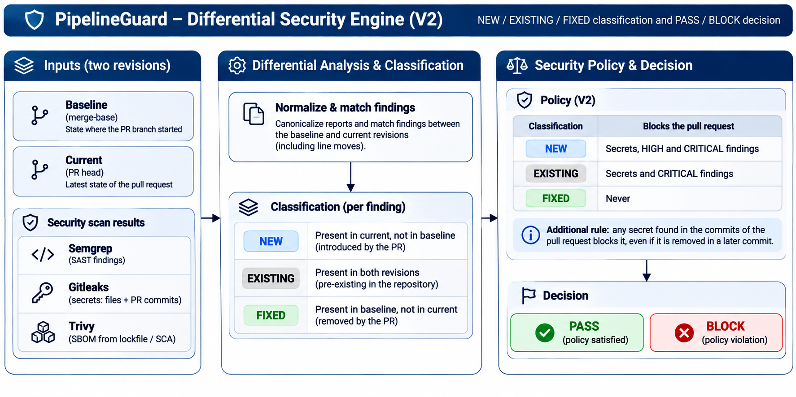

# Differential Security Engine

[Back to README](../README.md)

## Overview

The PipelineGuard V2 engine evaluates pull requests by comparing security findings between two Git revisions.

Instead of blocking every pull request because of existing security debt, it distinguishes newly introduced findings from existing and resolved findings.

The engine is deterministic and independent of the local LLM assistant.

## 1. Git Revision Comparison

The engine compares two revisions:

- **Baseline:** the merge-base between the target branch and the pull request head.
- **Current:** the head commit of the pull request.

Using the merge-base prevents changes introduced independently on the target branch from being incorrectly attributed to the pull request.

The approved engine, policy and scanner configuration are loaded from the base commit, not from the candidate code.

## 2. Finding Normalization

Semgrep, Gitleaks and Trivy produce reports with different structures.

The normalization layer converts these reports into a common finding representation so that the engine can compare and evaluate them consistently.

Semgrep severity mapping:

| Scanner severity | Engine severity |
|---|---|
| ERROR | HIGH |
| WARNING | MEDIUM |
| INFO | INFO |

File paths must be canonical and repository-relative.

Invalid or ambiguous paths are rejected rather than silently normalized into potentially incorrect findings.

## 3. Differential Classification

Each finding is classified according to its presence in the baseline and current revisions.

| Baseline | Current | Classification |
|---|---|---|
| Absent | Present | NEW |
| Present | Present | EXISTING |
| Present | Absent | FIXED |

### Line Mapping

Adding or removing source lines can change the location of a finding without changing the underlying security issue.

The engine uses Git diff hunks to translate line positions and match findings whose locations have moved.

For example:

- Baseline: an eval() finding at line 20.
- Current: the same finding at line 23 after three lines were inserted above it.
- Classification: EXISTING, not NEW.

This prevents unnecessary blocking caused by source code line shifts.

## 4. Security Policy

The deterministic policy engine evaluates the classified findings.

| Classification | Blocking conditions |
|---|---|
| NEW | Secrets, HIGH and CRITICAL findings |
| EXISTING | Secrets and CRITICAL findings |
| FIXED | Never blocks |

Existing HIGH findings do not block a pull request solely because they remain present.

However, existing secrets and CRITICAL findings remain blocking because of their security impact.

### Secrets in Pull Request History

Gitleaks also scans the commits introduced by the pull request.

A secret detected in these commits blocks the pull request even if a subsequent commit removes it from the source code.

Once pushed, a secret must be considered exposed and should be revoked or rotated.

## 5. Evidence Validation

Before applying the security policy, the engine verifies the required security evidence.

Validation includes:

- Required scanner reports.
- Report structure and consistency.
- Git revision consistency.
- Canonical repository-relative paths.
- Gitleaks exit code and report consistency.
- SBOM inventory and Trivy dependency coverage.
- SHA-256 report manifest integrity.

The manifest detects changes to scanner reports between the scan and decision jobs. It does not independently prove their origin or correctness.

## 6. Fail-Closed Behaviour

PipelineGuard follows a fail-closed approach.

Missing, invalid or inconsistent security evidence results in BLOCK.

A scanner failure must not be interpreted as an absence of security findings.

| Condition | Decision |
|---|---|
| Valid evidence and no blocking findings | PASS |
| Blocking finding detected | BLOCK |
| Required report missing | BLOCK |
| Malformed or inconsistent report | BLOCK |
| Report integrity verification failed | BLOCK |

## 7. Decision Examples

| Scenario | Classification | Decision |
|---|---|---|
| Newly introduced HIGH Semgrep finding | NEW | BLOCK |
| Existing HIGH finding remains unchanged | EXISTING | PASS* |
| Existing CRITICAL dependency vulnerability | EXISTING | BLOCK |
| Previously detected vulnerability removed | FIXED | PASS* |
| Secret added and removed within PR commits | PR history finding | BLOCK |

*Assuming all other security controls pass.

## 8. Implementation

The engine is implemented in Python.

| Module | Responsibility |
|---|---|
| `normalizer.py` | Normalize scanner reports |
| `differential.py` | Classify findings |
| `line_mapping.py` | Match findings across source line changes |
| `git_comparison.py` | Verify Git revision comparisons |
| `policy.py` | Apply blocking rules |
| `orchestrator.py` | Coordinate the evaluation process |
| `provenance.py` | Verify report manifest integrity |
| `pr_cli.py` | V2 command-line entry point |

Source code: [engine/](../engine/)

## 9. Separation from Artificial Intelligence

The engine never imports or invokes the LLM assistant.

The PASS/BLOCK decision depends exclusively on validated scanner evidence and deterministic security rules.

LLM-generated explanations, remediation suggestions and false-positive hints cannot override the security policy.

## 10. Known Limitations

- Detection coverage depends on scanner rules, databases and configuration.
- No exception mechanism is currently implemented.
- An existing CRITICAL finding can block every pull request until it is resolved.
- PASS does not guarantee the absence of vulnerabilities.

For additional information, see:

- [Architecture](architecture.md)
- [Security Controls and Limitations](security.md)
- [Validation](validation.md)
