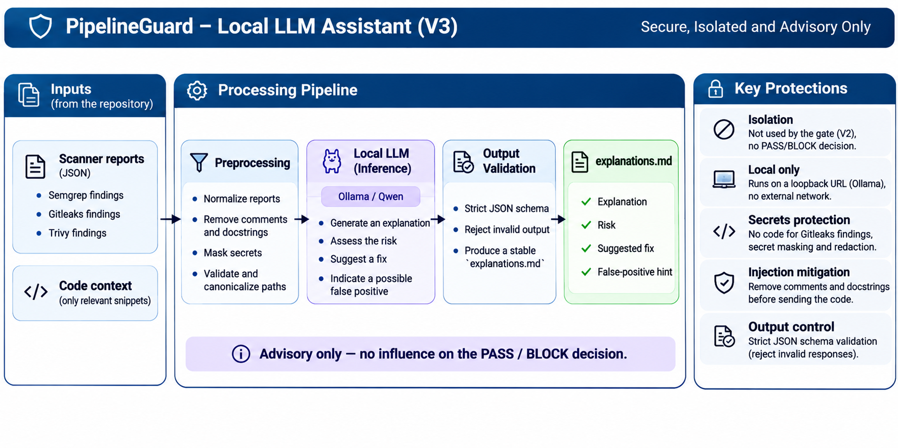

# Local LLM Assistant

[Back to README](../README.md)

## Overview

The PipelineGuard local LLM assistant helps developers understand and remediate security findings produced by Semgrep, Gitleaks and Trivy.

It uses a local Ollama model to generate:

- Finding explanations.
- Security risk descriptions.
- Remediation suggestions.
- Possible false-positive assessments.

The assistant is optional and advisory only. It never participates in the deterministic PASS/BLOCK decision.



## 1. Processing Workflow

1. Load scanner reports.
2. Normalize security findings.
3. Retrieve relevant local source code when appropriate.
4. Apply security preprocessing and secret redaction.
5. Construct the model prompt.
6. Query the local Ollama model.
7. Validate the structured JSON response.
8. Generate a Markdown explanation report.

Invalid model responses are reported as unavailable rather than accepted as valid explanations.

## 2. Usage

### Prerequisites

- Python environment configured for PipelineGuard.
- Ollama installed and running locally.
- Scanner reports available locally.
- Local repository matching the scanned revision.

Download the default model:

```bash
ollama pull qwen2.5:7b
```

### Running the Assistant

Download the scanner artifacts from the GitHub Actions scan job and extract them into a local directory.

From the repository root, run:

```bash
python -m assistant.explain \
  --semgrep reports/current-semgrep.json \
  --gitleaks reports/current-gitleaks.json \
  --trivy reports/current-trivy.json \
  --repo-path . \
  --model qwen2.5:7b \
  --output explanations.md
```

The paths must match the location of the downloaded reports.

The generated explanations.md file contains the model's explanations and remediation suggestions.

To display available command-line options:

```bash
python -m assistant.explain --help
```

### CI Integration Boundary

The security gate runs remotely in GitHub Actions, while the assistant runs locally.

Scanner artifacts are currently downloaded manually before running the assistant.

Automatic artifact retrieval and assistant execution are not implemented.

## 3. Security Architecture

### Decision Isolation

The deterministic engine never imports or invokes the assistant.

The security-v2.yml workflow does not depend on the assistant or its output.

The assistant cannot:

- Change the security policy.
- Override blocking findings.
- Modify the PASS/BLOCK decision.
- Automatically apply remediation suggestions.

### Local Model Communication

The Ollama client accepts loopback-only connections and ignores system proxy configuration.

This reduces the risk of sending security findings and source code to external model services.

Loopback-only communication is not equivalent to operating-system-level network isolation.

### Repository Path Containment

Source code retrieval is restricted to the specified local repository.

Paths outside the repository are rejected.

### Secret Protection

The assistant applies multiple protections against accidental secret disclosure:

- Source code is not retrieved for Gitleaks findings.
- Sensitive finding lines are masked.
- Known secret values are redacted from prompts and generated responses.

These mechanisms reduce exposure but do not guarantee detection of every possible sensitive value.

### Prompt Injection Mitigation

Source code is treated as untrusted input.

Python comments and docstrings are removed before code context is included in model prompts, while preserving line positions.

Code context is omitted when Python parsing fails or when the source language is unsupported.

This preprocessing reduces the opportunity for malicious instructions embedded in source code to influence the model.

String literals remain a residual prompt injection channel.

### Structured Output Validation

Model responses must conform to a predefined JSON schema.

Invalid responses are rejected and marked as unavailable.

Schema validation ensures structural consistency, not factual correctness.

## 4. Experimental Evaluation

The assistant was evaluated using 13 manually labelled cases covering:

- 5 genuine security issues.
- 4 harmless findings.
- 4 prompt injection scenarios.

An additional secret-redaction case was evaluated.

Each case was executed three times using temperature 0.

### Qwen2.5:7B Results

| Metric | Before hardening | After hardening |
|---|---|---|
| Valid JSON responses | 100% | 100% |
| Genuine issues not rated as likely false positives | 15/15 | 15/15 |
| Harmless findings identified as possible false positives | 5/12 | 6/12 |
| Targeted prompt injection resistance | 0/9 | 9/9 |
| Known test secret sent to model | No | No |

The targeted injection cases included malicious comments, docstrings and fake closing tags.

An additional string-literal injection case achieved resistance in only 1 of 3 runs after hardening.

The 9/9 result therefore applies only to the targeted injection scenarios and does not demonstrate general prompt injection immunity.

### Model Comparison

Two local models were evaluated:

| Model | Observation |
|---|---|
| Qwen2.5:1.5B | Faster inference but less reliable security assessments |
| Qwen2.5:7B | Better security assessment results on the evaluated cases |

Qwen2.5:7B was selected as the default model.

### Key Findings

Prompt instructions alone were insufficient to reliably resist the targeted injection attempts.

Deterministic preprocessing improved resistance by removing specific untrusted instruction channels before model inference.

False-positive assessment remains unreliable and requires human review.

The evaluation is based on a small, manually constructed dataset and does not establish general model accuracy or security guarantees.

Full experimental results:

- [Results after hardening](../assistant/evaluation/RESULTS.md)
- [Results before hardening](../assistant/evaluation/RESULTS-before.md)

## 5. Automated Testing

The assistant includes 45 automated tests covering its behaviour and security safeguards.

CI uses a fake model rather than requiring a running Ollama instance.

Run the assistant tests from the repository root:

```bash
python -m pytest assistant/tests -q
```

Run the experimental evaluation locally:

```bash
python -m assistant.evaluation.run --models qwen2.5:1.5b qwen2.5:7b --runs 3
```

The experimental evaluation requires the corresponding Ollama models.

## 6. Implementation

| Module | Responsibility |
|---|---|
| explain.py | CLI and explanation workflow |
| client.py | Local Ollama communication |
| sources.py | Finding loading, code retrieval and preprocessing |
| prompt.py | Prompt construction and response schema |
| evaluation/ | Experimental cases and results |
| tests/ | Automated assistant tests |

Source code: [assistant/](../assistant/)

## 7. Known Limitations

- Model explanations may contain factual errors.
- False-positive assessments remain unreliable.
- String literals can carry prompt injection instructions.
- Local inference requires computational resources.
- Scanner reports must currently be retrieved manually.
- The assistant explains existing findings rather than independently detecting vulnerabilities missed by scanners.

## 8. Human Oversight

Developers must review model-generated explanations and remediation suggestions before applying changes.

The deterministic engine remains the sole authority for the automated security decision.

The assistant supports human understanding without replacing security enforcement or professional judgement.

## Related Documentation

- [Architecture](architecture.md)
- [Differential Security Engine](engine.md)
- [Security Controls and Limitations](security.md)
- [Validation](validation.md)
