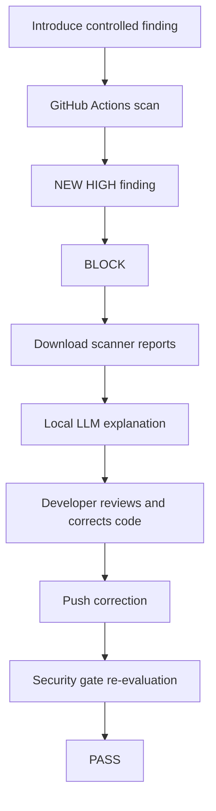

# Validation and Experimental Results

[Back to README](../README.md)

## Overview

PipelineGuard has been validated through automated tests, controlled security scenarios and real GitHub Actions executions.

The validation focuses on:

- Differential finding classification.
- Deterministic security decisions.
- Secret detection across PR commits.
- Security evidence integrity.
- Fail-closed behaviour.
- Local LLM assistant isolation and safeguards.

## 1. Automated Tests

| Component | Automated tests |
|---|---:|
| Security engine | 214 |
| LLM assistant | 45 |
| Total | 259 |

The demo application has a separate test suite.

### Security Engine Tests

The engine tests cover:

- Scanner report normalization.
- Differential finding classification.
- Git revision comparison.
- Source code line mapping.
- Security policy enforcement.
- Report integrity verification.
- SBOM validation.
- Invalid and missing security evidence.
- Workflow security safeguards.

### LLM Assistant Tests

The assistant tests cover:

- Finding processing.
- Repository path containment.
- Secret redaction.
- Prompt injection preprocessing.
- Structured response validation.
- Local model communication.
- Isolation from the security decision engine.

Automated assistant tests use a fake model and do not require Ollama.

## 2. Running the Tests

From the repository root:

```bash
python -m pytest engine/tests -q
python -m pytest assistant/tests -q
```

Run the demo application tests:

```bash
cd demo-app
python -m pytest -q
cd ..
```

### Semgrep Rule Tests

From the repository root:

```bash
docker run --rm --network none -v "$PWD:/work" -w /work \
  semgrep/semgrep:1.180.0@sha256:529ee8a277ec8adc5b534d7c74eea0a47e9de21d62852b6ba7ac6ba9566845c3 \
  semgrep --test --metrics=off --disable-version-check semgrep-rules/
```

Using Docker or Linux is recommended for Semgrep execution because native Windows reports may contain non-canonical path separators rejected by the engine.

## 3. Real GitHub Actions Validation

The security gate was validated through controlled pull requests in the actual GitHub Actions environment.

| Pull Request | Validation scenario | Observed result |
|---|---|---|
| [#20](https://github.com/islemfarhat1/PipelineGuard/pull/20) | Differential engine improvements | PASS |
| [#21](https://github.com/islemfarhat1/PipelineGuard/pull/21) | Newly introduced eval() finding | BLOCK |
| [#22](https://github.com/islemfarhat1/PipelineGuard/pull/22) | Test secret added and subsequently removed | BLOCK |
| [#23](https://github.com/islemfarhat1/PipelineGuard/pull/23) | Existing finding shifted by three lines | PASS |
| [#24](https://github.com/islemfarhat1/PipelineGuard/pull/24) | Tool integrity and offline Semgrep | PASS |
| [#25](https://github.com/islemfarhat1/PipelineGuard/pull/25) | New eval() finding with hardened scanners | BLOCK |
| [#26](https://github.com/islemfarhat1/PipelineGuard/pull/26) | Report manifest and non-root container | PASS |

PRs #21, #22, #23 and #25 were closed without merging.

PR #23 used a temporary target branch containing a harmless eval() expression to validate differential line matching without introducing a HIGH finding into main.

## 4. End-to-End Security Gate Demonstration

Pull request: [#33 — Security Gate Validation](https://github.com/islemfarhat1/PipelineGuard/pull/33)

This demonstration validates the complete developer workflow from finding detection to remediation.

### Stage 1: Introduce a Security Finding

A controlled eval() expression was added to the demo application:

```python
@app.get("/demo-calculation")
def demo_calculation():
    return {"result": eval("1 + 1")}
```

The expression uses a harmless constant and is not an exploitable vulnerability in this specific context.

Its purpose is to trigger the configured Semgrep security rule.

### Stage 2: Automated Security Decision

The GitHub Actions scan detected one newly introduced HIGH finding.

| Evidence | Observed result |
|---|---|
| Baseline Semgrep findings | 0 |
| Current Semgrep findings | 1 |
| Gitleaks findings | 0 |
| Trivy vulnerabilities | 0 |
| Differential classification | NEW |
| Security decision | BLOCK |

Observed decision:

```text
PipelineGuard PR Decision: BLOCK
```

Evidence: [GitHub Actions execution](https://github.com/islemfarhat1/PipelineGuard/actions/runs/46078689916)

### Stage 3: Local LLM Explanation

The scanner artifacts were downloaded locally.

The assistant was executed using Qwen2.5:7B and the current scanner reports.

Observed output:

```text
1 explained, 0 unavailable.
Advisory only: no security decision taken.
```

The assistant explained the potential risks of eval() and recommended replacing it with a direct calculation.

However, its false-positive assessment remained imperfect despite recognizing the harmless constant expression.

This illustrates why model-generated assessments require human review.

### Stage 4: Remediation

The expression was replaced with:

```python
@app.get("/demo-calculation")
def demo_calculation():
    return {"result": 1 + 1}
```

The correction was committed and pushed to the same pull request.

### Stage 5: Security Re-evaluation

GitHub Actions executed the security gate again.

Observed results:

| Check | Result |
|---|---|
| Continuous Integration | PASS |
| V2 Scan | PASS |
| V2 Security Decision | PASS |

Final decision:

```text
PipelineGuard PR Decision: PASS - All PR security controls passed
```

The finding was removed from the PR head. Since it was absent from the original baseline, this does not constitute a FIXED classification relative to the merge-base.

### Demonstration Summary



The LLM provides remediation assistance but never controls the security decision.

## 5. Security Hardening Validation

| Validation scenario | Expected behaviour |
|---|---|
| Missing scanner report | BLOCK |
| Malformed scanner report | BLOCK |
| Modified sealed report | BLOCK |
| Invalid manifest | BLOCK |
| Modified Gitleaks archive | Checksum verification fails |
| Invalid Semgrep rule test | CI fails |
| Secret removed in a later PR commit | BLOCK |
| Existing finding shifted to another line | Remains EXISTING |

These scenarios were evaluated through automated tests, controlled local checks and CI executions.

## 6. LLM Experimental Results

The local assistant was evaluated using manually labelled security findings and prompt injection scenarios.

| Metric | Observed result after hardening |
|---|---|
| Valid JSON responses | 100% |
| Targeted prompt injection resistance | 9/9 |
| Genuine issues not rated as likely false positives | 15/15 |
| Harmless findings identified as possible false positives | 6/12 |
| String-literal injection resistance | 1/3 |

Targeted prompt injection resistance improved from 0/9 to 9/9 following deterministic input preprocessing.

These results apply to the controlled experimental cases and do not establish general prompt injection resistance.

Detailed evaluation:

- [LLM Assistant Documentation](llm-assistant.md)
- [Experimental Results](../assistant/evaluation/RESULTS.md)
- [Results Before Hardening](../assistant/evaluation/RESULTS-before.md)

## 7. Validation Limitations

- The security scenarios were conducted in a controlled environment.
- The automated test count does not represent complete security coverage.
- The LLM evaluation dataset is small and manually constructed.
- Scanner findings do not necessarily represent exploitable vulnerabilities.
- A PASS decision does not guarantee vulnerability-free software.
- Production-scale performance and reliability have not been established.

## Conclusion

The validation demonstrates that PipelineGuard can detect configured security findings, classify them differentially, enforce deterministic policies and support developers through optional local AI-assisted remediation.

Security enforcement remains independent of the LLM.

## Related Documentation

- [Architecture](architecture.md)
- [Differential Security Engine](engine.md)
- [Security Controls and Limitations](security.md)
- [Local LLM Assistant](llm-assistant.md)
